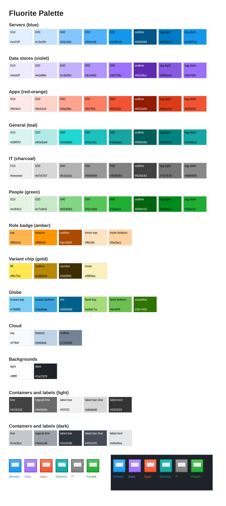

# Fluorite Palette

The colour palette of the [Strata architecture icons](https://github.com/bixb0012/strata-architecture-icons), as a standalone set you can use anywhere: diagrams, slides, documentation, web pages or your own icons.

## Colours

Each category has a ramp of tones: two pale tones (010, 020), three body tones (040, 050, 060), a dark outline, and a text colour for each background.

| Category | 010 | 020 | 040 | 050 | 060 | Outline | Text on light | Text on dark |
| --- | --- | --- | --- | --- | --- | --- | --- | --- |
| Servers | `#e1f1ff` | `#c3e2fe` | `#83c5fd` | `#50b1fd` | `#1497eb` | `#005589` | `#017bc3` | `#1497eb` |
| Data stores | `#efebff` | `#e0d8fe` | `#c3b0fd` | `#b194fd` | `#9d70fb` | `#6029b1` | `#885ae3` | `#9d70fb` |
| Apps | `#ffe9e4` | `#fed3c8` | `#fda38e` | `#fd7f63` | `#f25332` | `#931b00` | `#da3c18` | `#f25332` |
| General | `#d9f5f3` | `#b0ebe8` | `#20d8d3` | `#1bc1bc` | `#16a5a1` | `#005e5b` | `#018481` | `#16a5a1` |
| IT | `#eeeeee` | `#d7d7d7` | `#b1b1b1` | `#989898` | `#808080` | `#424242` | `#767676` | `#898989` |
| People | `#e3f4e2` | `#c7e9c6` | `#82d583` | `#55c559` | `#1fae31` | `#006410` | `#008a1c` | `#1fae31` |

The palette also includes:

- **Role badge (amber):** one colour for every role marker, so roles read the same in every category.
- **Variant chip (gold):** a small marker that sets variants apart.
- **Globe and cloud:** natural colours for depicted objects.
- **Backgrounds:** white, and `#1e2329` for the dark theme.
- **Containers and labels:** neutral greys for each theme.

## Using the colours

| Part | Colours |
| --- | --- |
| Body | Gradient from 050 (top) to 060 (bottom), with the outline colour |
| Pale panel (screens, insets) | Gradient from 010 to 020, with the outline colour |
| Top face (for example a cylinder's top) | Gradient from 040 to 050 |
| Text and labels | The text colour for your background |

The colour categories differ in hue but share the same OKLCH lightness steps, so they carry equal visual weight. IT is a neutral grey ramp, a step darker so grey bodies don't look washed out. Outlines contrast at least 2.5:1 with both body colours. Text colours meet 4.5:1 (WCAG AA) on their background.

## Files

| File | For |
| --- | --- |
| `tokens/fluorite.tokens.json` | Design tools and token pipelines ([Design Tokens Community Group format 2025.10](https://www.designtokens.org/tr/2025.10/): sRGB colour objects, with each hex as a fallback) |
| `tokens/fluorite.json` | Anything that reads a flat list of names and hex values, including token tools that don't read the 2025.10 format yet |
| `css/fluorite.css` | Web pages: CSS custom properties. The text and background roles follow the reader's system setting; `data-theme="dark"` or `data-theme="light"` on the page, or on any section of it, overrides it |
| `scss/_fluorite.scss` | Sass variables |
| `swatches/fluorite.ase` | Adobe Illustrator, Photoshop and InDesign |
| `swatches/fluorite.gpl` | GIMP, Inkscape and Krita |

## License

Fluorite Palette is released under the [MIT License](LICENSE). You can use it in any project, commercial or not. Keep the license notice when you redistribute the files.

A few individual values match colours in Esri's open [calcite-colors](https://github.com/Esri/calcite-colors) ramps. Fluorite is not affiliated with or endorsed by Esri.
